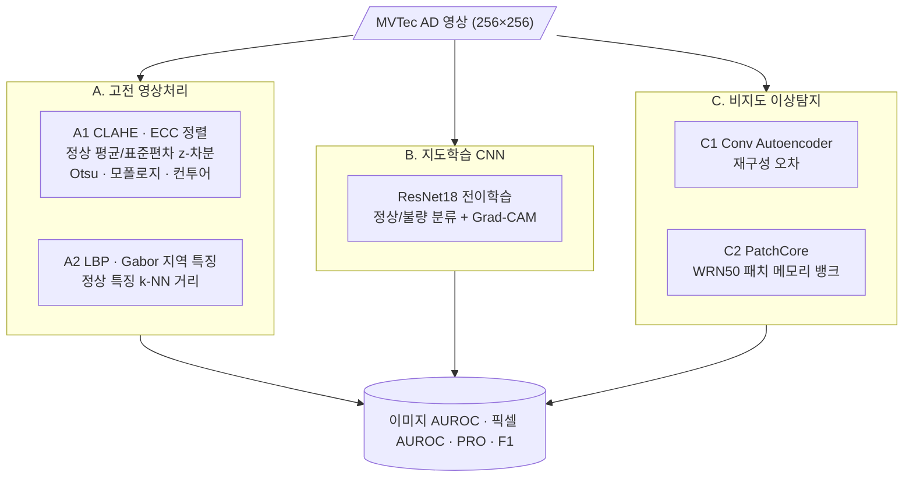
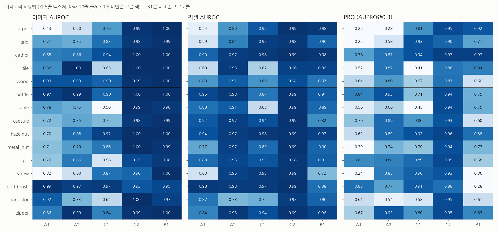
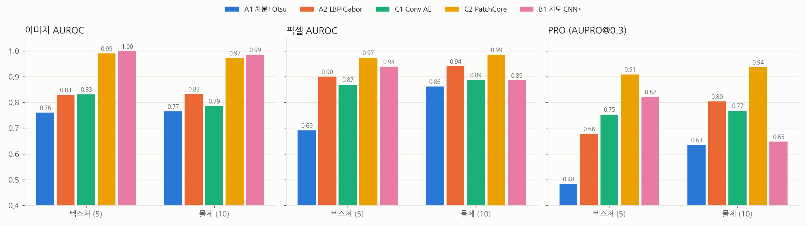
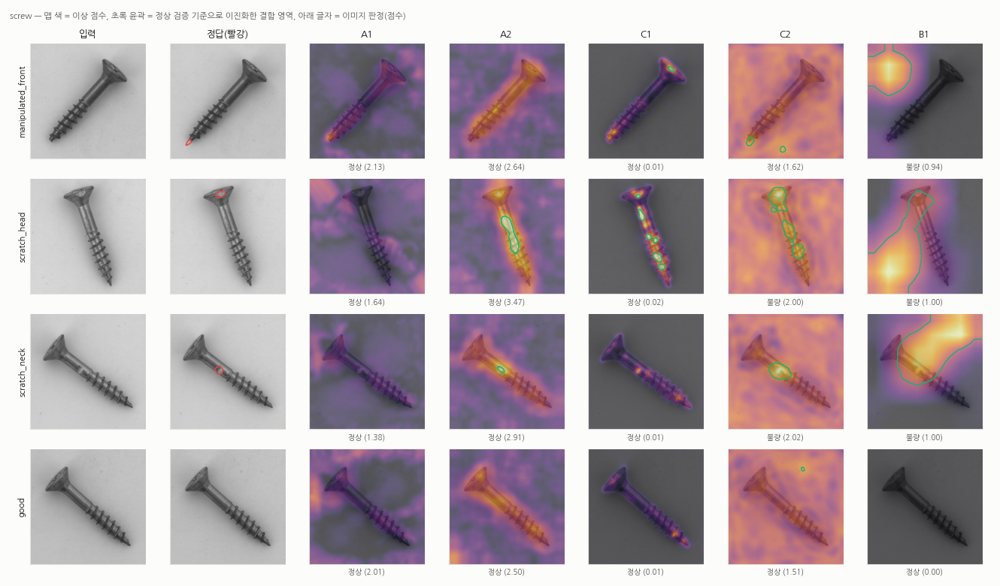
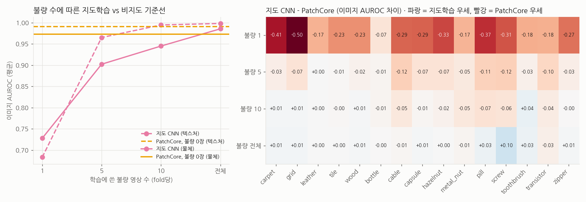

<div align="center">

# 🏭 Visual Defect Inspection Benchmark

**제조 외관 결함 검사: 고전 영상처리 vs 지도학습 CNN vs 비지도 이상탐지**


> 공장에서 불량 사진은 늘 부족합니다. **정상품 사진만으로** 불량을 잡을 수 있을까?<br/>
> 같은 데이터에서 세 계열의 방법을 비교하고, **언제 고전 기법으로 충분한지**까지 정리합니다.

</div>

---

## 📌 한눈에 보는 결론

MVTec AD 15개 카테고리, 시험 영상 1,725장, 모든 방법 같은 256×256 입력 · 같은 지표.

| | A1 차분+Otsu | A2 LBP·Gabor | C1 Conv AE | **C2 PatchCore** | B1 지도 CNN\* |
|---|---:|---:|---:|---:|---:|
| 이미지 AUROC | 0.764 | 0.832 | 0.801 | **0.979** | 0.990 |
| 픽셀 AUROC | 0.805 | 0.928 | 0.881 | **0.982** | 0.903 |
| PRO | 0.584 | 0.762 | 0.763 | **0.928** | 0.705 |
| F1 (정상 검증 임계값) | 0.486 | 0.688 | 0.502 | **0.950** | 0.905 |
| 학습 불량 영상 수 | 0 | 0 | 0 | **0** | 평균 67 |

\* B1은 시험 세트 불량을 5-fold로 학습에 쓴 **비표준 프로토콜**입니다(아래 [평가 프로토콜](#평가-프로토콜)).

1. **G1 — 정상품만으로 충분하다.** PatchCore는 불량 사진 0장으로 이미지 AUROC 0.979를 냈고, 픽셀 위치(PRO 0.928)는 평균 67장의 불량으로 학습한 지도 CNN(0.705)보다 훨씬 정확합니다.
2. **G2 — 고전 기법은 '조건이 맞으면' 충분하다.** 자세가 고정된 물체(toothbrush 0.989, bottle 0.971, transistor 0.915)에서는 평균 영상 차분(A1)이, 규칙적인 텍스처(tile 0.999, wood 0.931)와 bottle · zipper(0.99)에서는 LBP · Gabor(A2)가 PatchCore와 비슷합니다. 반대로 회전하는 물체(screw 0.32, hazelnut 0.70)와 불규칙 텍스처(carpet 0.43)에서는 실패합니다.
3. **G3 — 지도학습이 PatchCore를 따라잡으려면 불량이 꽤 필요하다.** 이미지 AUROC 평균으로 불량 10장(0.962)은 PatchCore(0.979)에 못 미치고, 전체(카테고리당 24~113장)를 써야 앞섭니다(0.990). 텍스처는 10장 근처에서 역전되지만, 물체 4개(bottle · cable · metal_nut · transistor)는 끝까지 역전되지 않습니다. **픽셀 위치는 어떤 불량 수에서도 PatchCore를 따라잡지 못합니다.**

---

## 🎯 목표

| # | 목표 | 결과 |
|:---:|---|---|
| G1 | MVTec AD 15개 카테고리에서 세 계열을 같은 지표로 비교 | [결과 표](#-결과) · [`results/summary.md`](results/summary.md) |
| G2 | 카테고리 성격(텍스처 vs 물체)에 따라 어떤 계열이 유리한지 분석 | [G2 분석](#g2--텍스처-vs-물체) |
| G3 | 불량 사진 수를 줄여 가며 지도학습이 비지도에 역전당하는 지점 확인 | [G3 분석](#g3--불량-몇-장이면-지도학습이-이기나) |

## 📌 문제 정의

외관 검사는 산업 컴퓨터비전 Lec 1에서 대표 응용으로 다룬 주제입니다. 현장에는 세 가지 선택지가 있습니다.

| 계열 | 장점 | 약점 |
|---|---|---|
| 고전 영상처리 (규칙) | 학습 데이터 불필요, 설명 가능, 빠름 | 제품·조명마다 규칙을 다시 짜야 함 |
| 지도학습 CNN | 정확도 높음 | **불량 사진이 많이 필요** |
| 비지도 이상탐지 | 정상품만으로 학습 | 결함 종류를 구분하지 못함, 임계값 설정 필요 |

---

## 🧭 구현한 방법



| ID | 파일 | 핵심 설정 |
|:---:|---|---|
| A1 | [`src/classical/diff_otsu.py`](src/classical/diff_otsu.py) | Lab 변환 → L 채널 CLAHE → 물체만 ECC 유클리드 정렬 → 픽셀별 z-점수 → σ=4 가우시안. 이진 영역은 max(Otsu, 정상 검증 99.9%) → 열림 · 닫힘 → 면적 30px 미만 컨투어 제거 |
| A2 | [`src/classical/texture_lbp_gabor.py`](src/classical/texture_lbp_gabor.py) | 32×32 창 · stride 4. LBP(P=8, R=1·2) 히스토그램 20 + Gabor(4방향×2파장) 에너지 8 + 밝기 · 색 4 = 32차원. 정상 특징 10만 개와 k=3 최근접 거리 |
| B | [`src/supervised/transfer_cnn.py`](src/supervised/transfer_cnn.py) · [`gradcam.py`](src/supervised/gradcam.py) | ImageNet ResNet18, 300 step × 배치 32(정상 · 불량 절반씩), AdamW 3e-4. 맵 = p(불량) × Grad-CAM(layer4) |
| C1 | [`src/unsupervised/conv_ae.py`](src/unsupervised/conv_ae.py) | 256 → 8×8×16 병목 → 256, 손실 MSE + (1−SSIM), 2,000 step |
| C2 | [`src/unsupervised/patchcore.py`](src/unsupervised/patchcore.py) | WideResNet-50 layer2+3, 3×3 지역 평균, 1536차원, greedy coreset 1%, 이미지 점수에 논문 식 (7) 재가중 |
| 평가 | [`src/eval/auroc.py`](src/eval/auroc.py) · [`pro.py`](src/eval/pro.py) | PRO는 MVTec 공식 정의(FPR 0~0.3 면적 / 0.3). 임계값별 brute-force 구현과 일치함을 테스트로 확인 |

증강: 텍스처는 뒤집기 · 90° 회전, 물체는 밝기 · 대비만 씁니다. **물체에 뒤집기를 쓰지 않는 이유는 metal_nut의 `flip` 결함이 좌우 반전된 너트이기 때문입니다.** 정상품을 뒤집으면 그 자체가 결함 영상이 됩니다.

### 평가 프로토콜

MVTec AD의 **학습 세트에는 정상품만** 있습니다.

| 계열 | 학습에 쓰는 것 | 임계값(F1용) |
|---|---|---|
| A · C | 정상 학습 영상의 85% | 나머지 15% 정상 검증 영상 점수의 99번째 백분위수. **시험 세트로 임계값을 정하지 않음** |
| B | 정상 학습 영상 전체 + 시험 세트를 결함 종류로 층화한 5-fold 중 4개 fold | 확률 0.5 |

- B는 모든 시험 영상이 자신을 학습에 쓰지 않은 fold 모델로 정확히 한 번 평가됩니다(out-of-fold). 그래서 A · C와 **같은 1,725장**으로 지표를 계산합니다. 다만 정상 검증 없이 시험 세트 불량을 학습에 쓰므로 표준 결과와 따로 표시합니다.
- F1-max(시험 세트로 고른 최적 임계값의 F1)는 오라클 참고값으로 [`results/summary.md`](results/summary.md)에만 둡니다.
- 하이퍼파라미터는 시험 세트로 튜닝하지 않았습니다. A2는 개발 중 정상 검증 영상에서도 점수 최댓값이 영상 가장자리에 몰리는 버그(경계 반사 패딩)를 발견해 고쳤습니다. 이 확인에는 정상 검증 영상만 썼습니다.

---

## 📊 결과



### 이미지 AUROC (카테고리별)

| 카테고리 | 유형 | A1 | A2 | C1 | C2 | B1\* |
|---|---|---:|---:|---:|---:|---:|
| carpet | 텍스처 | 0.425 | 0.604 | 0.792 | 0.987 | **1.000** |
| grid | 텍스처 | 0.773 | 0.753 | 0.878 | 0.980 | **0.993** |
| leather | 텍스처 | 0.851 | 0.862 | 0.939 | **1.000** | **1.000** |
| tile | 텍스처 | 0.820 | 0.999 | 0.646 | 1.000 | **1.000** |
| wood | 텍스처 | 0.933 | 0.931 | 0.902 | 0.989 | **1.000** |
| bottle | 물체 | 0.971 | 0.991 | 0.898 | **1.000** | 0.999 |
| cable | 물체 | 0.779 | 0.752 | 0.504 | **0.994** | 0.982 |
| capsule | 물체 | 0.721 | 0.764 | 0.724 | 0.982 | **0.993** |
| hazelnut | 물체 | 0.695 | 0.884 | 0.966 | **1.000** | **1.000** |
| metal_nut | 물체 | 0.711 | 0.786 | 0.861 | **1.000** | 0.987 |
| pill | 물체 | 0.698 | 0.858 | 0.584 | 0.950 | **0.980** |
| screw | 물체 | 0.320 | 0.605 | 0.874 | 0.898 | **1.000** |
| toothbrush | 물체 | **0.989** | 0.969 | 0.975 | 0.925 | 0.953 |
| transistor | 물체 | 0.915 | 0.730 | 0.637 | **0.997** | 0.967 |
| zipper | 물체 | 0.857 | 0.990 | 0.841 | 0.988 | **0.998** |
| **평균** | | 0.764 | 0.832 | 0.801 | 0.979 | 0.990 |

픽셀 AUROC · PRO · F1의 카테고리별 표는 [`results/summary.md`](results/summary.md)에, 원자료는 [`results/all_metrics.csv`](results/all_metrics.csv)에 있습니다. PatchCore 수치는 원 논문(1% coreset, 이미지 AUROC 99.0)과 비슷한 수준이라 구현 검증 역할도 합니다.

### G2 — 텍스처 vs 물체



| 관찰 | 근거 |
|---|---|
| **A1 차분은 '정해진 자세'가 있어야 작동한다** | 고정 자세 물체에서 강함: toothbrush 0.989, bottle 0.971, transistor 0.915. 임의 회전 물체에서는 ECC 정렬이 수렴하지 못함: screw 0.320(우연보다 낮음), hazelnut 0.695, metal_nut 0.711. 텍스처는 평균 영상이 의미 없는 회색 판이라 carpet 0.425 |
| **A2 텍스처 특징은 '규칙적인' 표면에서만 충분하다** | tile 0.999, wood 0.931로 PatchCore와 근접하지만, 미세하고 불규칙한 carpet은 0.604. 물체에서도 위치를 보지 않는 지역 특징이라 bottle · zipper(0.99)는 잘 잡고, 부품 배치가 의미인 transistor(0.730) · cable(0.752)은 못 잡음 |
| **C1 오토인코더는 고전 기법보다 낫지 않다** | 평균 0.801로 A2(0.832)보다 낮음. 복원이 흐릿해 정상의 미세 구조(tile 0.646)나 색 조합(cable 0.504, pill 0.584)에서 정상 오차와 결함 오차가 섞임. 반대로 hazelnut(0.966)처럼 배경이 단순하면 잘 작동 |
| **PatchCore는 유형을 가리지 않는다** | 텍스처 0.991 / 물체 0.973. 가장 약한 곳도 screw 0.898, toothbrush 0.925(학습 정상 60장으로 가장 적음) |
| **지도 CNN은 '맞히지만 어디인지는 잘 모른다'** | 이미지 AUROC는 최고(0.990)지만 PRO는 물체에서 0.647로 A2(0.804)보다도 낮음. 아래 screw 갤러리처럼 이미지 판정은 맞는데 Grad-CAM이 나사가 아닌 **배경**을 가리키는 경우가 있음 → 결함이 아닌 지름길 단서를 학습했을 위험 |



<sub>열: 입력 · 정답(빨강) · 각 방법의 이상 맵. 초록 윤곽은 정상 검증 영상으로 정한 기준으로 이진화한 결함 영역, 아래 글자는 이미지 판정. 15개 카테고리 전부 [`results/gallery/`](results/gallery/)에 있습니다.</sub>

### G3 — 불량 몇 장이면 지도학습이 이기나



| 학습 불량 수(fold당) | 1 | 5 | 10 | 전체 (24~113, 평균 67) | PatchCore (0장) |
|---|---:|---:|---:|---:|---:|
| 이미지 AUROC — 텍스처 | 0.683 | 0.965 | 0.995 | **0.998** | 0.991 |
| 이미지 AUROC — 물체 | 0.728 | 0.902 | 0.945 | **0.986** | 0.973 |
| 픽셀 AUROC — 전체 | 0.539 | 0.732 | 0.800 | 0.903 | **0.982** |
| PRO — 전체 | 0.182 | 0.374 | 0.471 | 0.705 | **0.928** |

- **텍스처: 불량 약 10장에서 역전.** carpet · grid · wood는 10장, leather는 5장에서 PatchCore와 같거나 앞섭니다(tile은 PatchCore가 이미 1.000이라 전체에서 동률). 텍스처 결함은 '정상과 다른 무늬'라는 공통점이 있어 적은 예시로도 일반화됩니다.
- **물체: 대부분 불량 전체가 필요하고, 4개는 끝까지 못 이긴다.** toothbrush만 10장에서 앞서고(PatchCore가 정상 60장으로 약함), capsule · hazelnut · pill · screw · zipper는 전체(56~113장)를 써야 앞서며, bottle · cable · metal_nut · transistor는 전체를 써도 PatchCore 아래입니다. 물체 결함은 종류마다 모양이 달라(cable 8종, pill 7종) 보지 못한 종류로 일반화되지 않습니다.
- **불량 1장은 비지도의 대안이 아니다.** 평균 0.713으로 고전 기법 A1(0.764)보다도 낮습니다.
- **위치는 어떤 불량 수에서도 역전되지 않는다.** 분류 손실만으로 학습한 CNN의 Grad-CAM은 8×8 해상도이고, 결함 위치를 직접 학습하지 않습니다.

---

## 🧰 어떤 경우에 어떤 방법을 쓸까

| 상황 | 권장 | 이유 (이 벤치마크 근거) |
|---|---|---|
| 불량 사진이 없거나 수십 장 미만 | **PatchCore (C2)** | 불량 0장으로 이미지 0.979 · PRO 0.928. 학습은 카테고리당 수 초(1% coreset) |
| 지그 · 컨베이어로 **자세가 고정**된 물체, GPU 없음 | **A1 평균 영상 차분** | toothbrush 0.989 · bottle 0.971. 영상 1장 약 7ms(CPU), 규칙을 그대로 설명할 수 있음 |
| **규칙적인 텍스처** 표면(타일, 목재), GPU 없음 | **A2 LBP · Gabor** | tile 0.999 · wood 0.931 |
| 물체가 **회전**하거나 텍스처가 **불규칙** | 고전 기법 쓰지 말 것 | screw A1 0.320, carpet A1 0.425 |
| 불량 위치(영역)까지 필요 | PatchCore | 지도 CNN의 Grad-CAM은 PRO 0.705, 배경을 가리키는 사례 있음 |
| 결함 **종류**를 구분해야 하고 종류별 수십 장이 있음 | 지도 CNN (+ 위치는 PatchCore 병행) | 이상탐지는 종류를 모름. 텍스처는 10장, 물체는 종류별 다수가 필요 |
| 오토인코더 재구성 오차 | 기준선 이상으로 권하지 않음 | 평균 0.801로 A2보다 낮고 학습이 가장 오래 걸림(카테고리당 약 95초) |

### 현장성

| 방법 | 추론 ms/장 | 학습 시간 | 학습 정상 수 | 학습 불량 수 | 설명 가능성 |
|---|---:|---:|---:|---:|---|
| A1 | 6.7 (CPU) | 12초 | 206 | 0 | 높음: "평균 영상 대비 z-점수 n 이상인 영역" |
| A2 | 141 (CPU 특징 + GPU k-NN) | 41초 | 206 | 0 | 중간: 어떤 텍스처 특징이 다른지 확인 가능 |
| C1 | 2.5 | 95초 | 206 | 0 | 중간: 복원 영상과 나란히 볼 수 있음 |
| C2 | 5.7 | 3초 | 206 | 0 | 중간: 가장 가까운 정상 패치를 근거로 제시 가능 |
| B1 | 2.0 | 8초 × 5 fold | 242 | 67 | 낮음: Grad-CAM이 결함과 다른 곳을 가리킬 수 있음 |

<sub>시간은 15개 카테고리 중앙값, RTX 5060 Ti. 실험 일부는 다른 학습 작업과 GPU를 공유한 상태에서 측정되어 절대값은 ±수 배 오차가 있을 수 있습니다. 상대적인 크기 비교용으로만 보세요.</sub>

---

## 🚀 재현

```bash
uv sync                                   # Python 3.10, torch 2.11 + cu128
bash scripts/download_mvtec.sh            # ~5.3GB, SHA-256 검증 후 ~/data/mvtec_ad 에 해제
ln -s ~/data/mvtec_ad data                # configs/default.yaml 의 data_root
uv run python -m scripts.prepare_cache    # 256×256 리사이즈 캐시 (약 1분)
bash scripts/run_all.sh                   # 전체 실험 + 리포트 (GPU 단독 사용 시 약 1시간)

# 개별 실행
uv run python -m src.run --method C2 --categories bottle screw
uv run python -m src.run --method B  --categories carpet   # B1 + B2(불량 1·5·10)
uv run python -m scripts.make_report
uv run pytest                                              # 24개 테스트
```

- 데이터: 공식 배포는 신청서 뒤에 있어 Hugging Face 미러를 씁니다. 아카이브 SHA-256(`cf4313b1…`)이 anomalib이 공식 아카이브에 쓰는 값과 같은지 스크립트가 확인합니다.
- 설정: [`configs/default.yaml`](configs/default.yaml). 시드 0 고정.

## 📁 디렉토리 구조

```
Visual-Defect-Inspection-Benchmark/
├── configs/default.yaml   실험 설정 (방법별 하이퍼파라미터, 분할 비율, 임계값 분위수)
├── scripts/               download_mvtec.sh · prepare_cache.py · run_all.sh · make_report.py
├── src/
│   ├── data/              mvtec.py (로더 · 캐시) · splits.py (fit/val, 결함 층화 k-fold, 불량 샘플링)
│   ├── classical/         diff_otsu.py · texture_lbp_gabor.py
│   ├── supervised/        transfer_cnn.py · gradcam.py
│   ├── unsupervised/      conv_ae.py · patchcore.py
│   ├── eval/              auroc.py (AUROC · F1) · pro.py
│   ├── common.py          공통 인터페이스 · 증강 · k-NN
│   └── run.py             실험 실행기
├── tests/                 지표(brute-force 대조) · 데이터 · 방법 스모크 테스트
└── results/
    ├── summary.md         전체 표 (자동 생성)
    ├── all_metrics.csv    · metrics/<방법>.csv
    ├── figures/           히트맵 · 텍스처 vs 물체 · 불량 수 곡선 · 정확도 vs 속도
    └── gallery/           카테고리별 결함 맵 갤러리 15장
```

## ⚠️ 한계

| 한계 | 영향 |
|---|---|
| 시드 1개 | B2의 불량 1 · 5장 결과는 어떤 불량을 뽑느냐에 크게 좌우됨. 5개 fold가 서로 다른 불량을 뽑아 일부 평균되지만, 신뢰구간은 내지 않음 |
| B는 시험 세트 일부로 학습 | 같은 1,725장으로 평가하지만 학습 분포가 시험 분포와 같은 공장 · 같은 시기라 실제보다 유리할 수 있음 |
| 256×256 단일 해상도 | 원본(700~1024px) 대비 미세 결함(screw 나사산 등)이 작아짐. 모든 방법에 동일하게 적용 |
| A · C는 정상 학습 영상의 85%만 사용 | 표준 프로토콜보다 학습 영상이 적음. 대신 시험 세트를 보지 않고 임계값을 정할 수 있음 |
| C1은 단순한 구조 1개 | 최신 재구성 기반 방법(예: DRAEM)을 대표하지 않음 |

## 🔗 기반 수업과 저장소

| 수업 / 프로젝트 | 가져온 것 | 저장소 |
|---|---|---|
| 산업 컴퓨터비전 | CLAHE(Lec 3), Gabor 필터·이진화·모폴로지(Lec 4), 엣지·컨투어(Lec 5), LBP(Lec 12) | [industrial_computor_vision](https://github.com/cbnu-yhjeon/industrial_computor_vision) |
| 영상처리 실체 | 필터링, 모폴로지, 이진화 실습 | [Image-Processing-Entities](https://github.com/cbnu-yhjeon/Image-Processing-Entities) |
| 견종 인식 | 전이학습, 데이터 증강 | [PROJECT-Breed-Recognition-Program](https://github.com/cbnu-yhjeon/PROJECT-Breed-Recognition-Program) |
| 차량 CAN 이상탐지 | 오토인코더 재구성 오차 기반 이상탐지 | [PROJECT-CAN-Anomaly-Detection](https://github.com/cbnu-yhjeon/PROJECT-CAN-Anomaly-Detection) |
| 패턴인식 · 딥러닝 실체 · 지능화 캡스톤 | CNN 분류, 학습 기법 | [Pattern_Rcognition](https://github.com/cbnu-yhjeon/Pattern_Rcognition) · [Deep-Learning-Entities](https://github.com/cbnu-yhjeon/Deep-Learning-Entities) · [capston-pilot](https://github.com/cbnu-yhjeon/capston-pilot) |

## 🗂️ 데이터

| 데이터 | 내용 | 비고 |
|---|---|---|
| [MVTec AD](https://www.mvtec.com/company/research/datasets/mvtec-ad) | 15개 카테고리(텍스처 5 · 물체 10), 학습 3,629장(정상) + 시험 1,725장, 픽셀 단위 결함 마스크 | **CC BY-NC-SA 4.0** (비상업). 저장소에 포함하지 않음 |

## 📚 참고 자료

- P. Bergmann et al., *MVTec AD — A Comprehensive Real-World Dataset for Unsupervised Anomaly Detection*, CVPR 2019
- P. Bergmann et al., *The MVTec Anomaly Detection Dataset*, IJCV 2021 (PRO 정의)
- K. Roth et al., *Towards Total Recall in Industrial Anomaly Detection* (PatchCore), CVPR 2022
- R. Selvaraju et al., *Grad-CAM*, ICCV 2017
- [anomalib](https://github.com/openvinotoolkit/anomalib)
