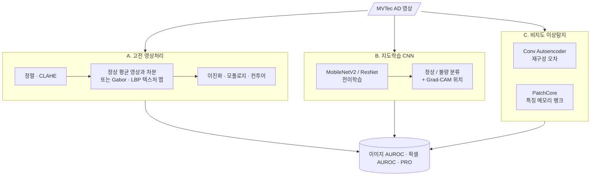

<div align="center">

# 🏭 Visual Defect Inspection Benchmark

**제조 외관 결함 검사: 고전 영상처리 vs 지도학습 CNN vs 비지도 이상탐지**


> 공장에서 불량 사진은 늘 부족합니다. **정상품 사진만으로** 불량을 잡을 수 있을까?<br/>
> 같은 데이터에서 세 계열의 방법을 비교하고, **언제 고전 기법으로 충분한지**까지 정리합니다.

</div>

> [!NOTE]
> 🚧 **계획 단계입니다.** 아직 코드가 없고, 이 README는 프로젝트 설계서입니다.

---

## 📌 문제 정의

외관 검사는 산업 컴퓨터비전 Lec 1에서 대표 응용으로 다룬 주제입니다. 현장에는 세 가지 선택지가 있습니다.

| 계열 | 장점 | 약점 |
|---|---|---|
| 고전 영상처리 (규칙) | 학습 데이터 불필요, 설명 가능, 빠름 | 제품·조명마다 규칙을 다시 짜야 함 |
| 지도학습 CNN | 정확도 높음 | **불량 사진이 많이 필요** |
| 비지도 이상탐지 | 정상품만으로 학습 | 결함 종류를 구분하지 못함, 임계값 설정 필요 |

## 🎯 목표

| # | 목표 |
|:---:|---|
| G1 | MVTec AD 15개 카테고리에서 세 계열을 같은 지표로 비교 |
| G2 | 카테고리 성격(텍스처 vs 물체)에 따라 어떤 계열이 유리한지 분석 |
| G3 | 불량 사진 수를 줄여 가며 지도학습이 비지도에 역전당하는 지점 확인 |

---

## 🔗 기반 수업과 저장소

| 수업 / 프로젝트 | 가져올 것 | 저장소 |
|---|---|---|
| 산업 컴퓨터비전 | CLAHE(Lec 3), Gabor 필터·이진화·모폴로지(Lec 4), 엣지·컨투어(Lec 5), 분할(Lec 6), LBP·HoG(Lec 12) | [industrial_computor_vision](https://github.com/cbnu-yhjeon/industrial_computor_vision) |
| 영상처리 실체 | 필터링, 모폴로지, 이진화 실습 | [Image-Processing-Entities](https://github.com/cbnu-yhjeon/Image-Processing-Entities) |
| 견종 인식 | MobileNetV2 전이학습, 데이터 증강 | [PROJECT-Breed-Recognition-Program](https://github.com/cbnu-yhjeon/PROJECT-Breed-Recognition-Program) |
| 차량 CAN 이상탐지 | 오토인코더 재구성 오차 기반 이상탐지, Isolation Forest | [PROJECT-CAN-Anomaly-Detection](https://github.com/cbnu-yhjeon/PROJECT-CAN-Anomaly-Detection) |
| 패턴인식 · 딥러닝 실체 · 지능화 캡스톤 | CNN 분류(캡스톤 4~8주차), 학습 기법 | [Pattern_Rcognition](https://github.com/cbnu-yhjeon/Pattern_Rcognition) · [Deep-Learning-Entities](https://github.com/cbnu-yhjeon/Deep-Learning-Entities) · [capston-pilot](https://github.com/cbnu-yhjeon/capston-pilot) |

---

## 🧭 접근 방법



### 평가 프로토콜 주의
MVTec AD의 **학습 세트에는 정상품만** 있습니다. 그래서 계열마다 학습 방식을 이렇게 나눕니다.

| 계열 | 학습에 쓰는 것 | 비고 |
|---|---|---|
| A. 고전 | 정상 학습 영상(평균 영상·임계값 결정) | 표준 프로토콜 |
| C. 비지도 | 정상 학습 영상 | 표준 프로토콜 |
| B. 지도학습 | 정상 학습 영상 + **시험 세트 불량 일부** | 표준이 아님. 불량을 k-fold로 나눠 학습·평가하고, 결과를 따로 표시 |

---

## 🗂️ 데이터

| 데이터 | 내용 | 비고 |
|---|---|---|
| [MVTec AD](https://www.mvtec.com/company/research/datasets/mvtec-ad) | 15개 카테고리(텍스처 5 · 물체 10), 총 5,354장, 픽셀 단위 결함 마스크 | **CC BY-NC-SA 4.0** (비상업) |

---

## 🧪 실험 설계

| ID | 방법 | 확인할 것 |
|:---:|---|---|
| A1 | 정상 평균 영상과의 차분 + Otsu + 모폴로지 | 정렬된 물체 카테고리에서의 한계 |
| A2 | Gabor · LBP 텍스처 특징 + 지역 이상 점수 | 텍스처 카테고리에서의 성능 |
| B1 | 전이학습 CNN (불량 k-fold) | 상한선 |
| B2 | B1에서 불량 학습 수를 1 · 5 · 10 · 전체로 변경 | 비지도에 역전당하는 지점 (G3) |
| C1 | Conv Autoencoder | 재구성 기반 기준선 |
| C2 | PatchCore | 최신 기준선 |

### 지표

- **이미지 단위:** AUROC, 고정 임계값에서의 F1
- **픽셀 단위:** AUROC, PRO (Per-Region Overlap)
- **현장성:** 영상 1장 추론 시간, 학습에 필요한 영상 수, 결과 설명 가능성(정성)

---

## 🗓️ 마일스톤

| 주차 | 내용 | 산출물 |
|:---:|---|---|
| 1 | 데이터 로더, 평가 스크립트(AUROC · PRO) | 공통 평가 코드 |
| 2 | 고전 기법 A1 · A2 | 카테고리별 결과 |
| 3 | Conv Autoencoder C1 | 재구성 오차 맵 |
| 4 | PatchCore C2 | 최신 기준선 결과 |
| 5 | 지도학습 B1 · B2 | 불량 수별 곡선 |
| 6 | 카테고리별 분석, 실패 사례, 정리 | "어떤 경우에 어떤 방법을 쓸까" 가이드 |

## 📁 디렉토리 구조 (계획)

```
Visual-Defect-Inspection-Benchmark/
├── src/
│   ├── data/           MVTec 로더, k-fold 분할
│   ├── classical/      diff_otsu.py · texture_lbp_gabor.py
│   ├── supervised/     transfer_cnn.py · gradcam.py
│   ├── unsupervised/   conv_ae.py · patchcore.py
│   └── eval/           auroc.py · pro.py
├── results/            카테고리별 표, 결함 맵 갤러리
└── README.md
```

## ⚠️ 리스크와 대응

| 리스크 | 대응 |
|---|---|
| 지도학습이 시험 세트 불량을 학습에 써서 비교가 불공정해 보임 | 표준 프로토콜 결과와 분리해서 표기, k-fold로 누수 방지 |
| 고전 기법의 임계값을 시험 세트로 정하면 과적합 | 정상 학습 영상의 점수 분포(예: 99번째 백분위수)로만 임계값 결정 |
| PatchCore 메모리 사용량 | Coreset 샘플링 비율 조정 |

## 📚 참고 자료

- P. Bergmann et al., *MVTec AD — A Comprehensive Real-World Dataset for Unsupervised Anomaly Detection*, CVPR 2019
- K. Roth et al., *Towards Total Recall in Industrial Anomaly Detection* (PatchCore), CVPR 2022
- [anomalib](https://github.com/openvinotoolkit/anomalib)
- R. Selvaraju et al., *Grad-CAM*, ICCV 2017
